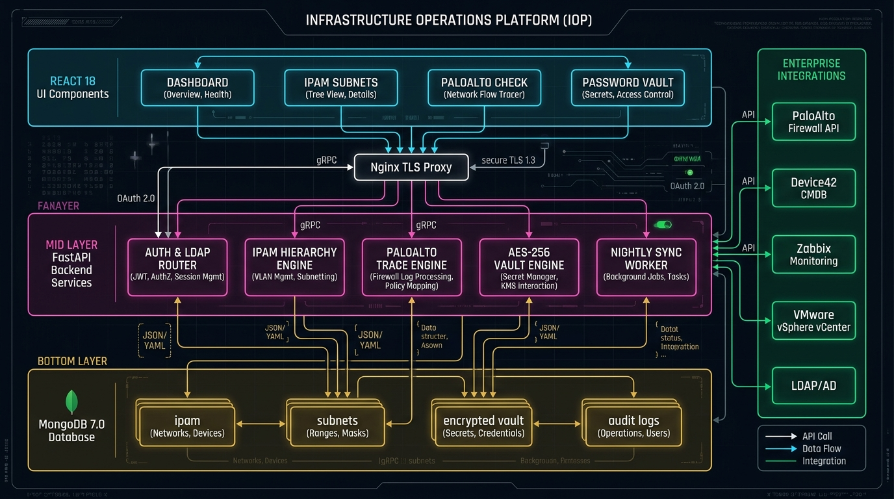
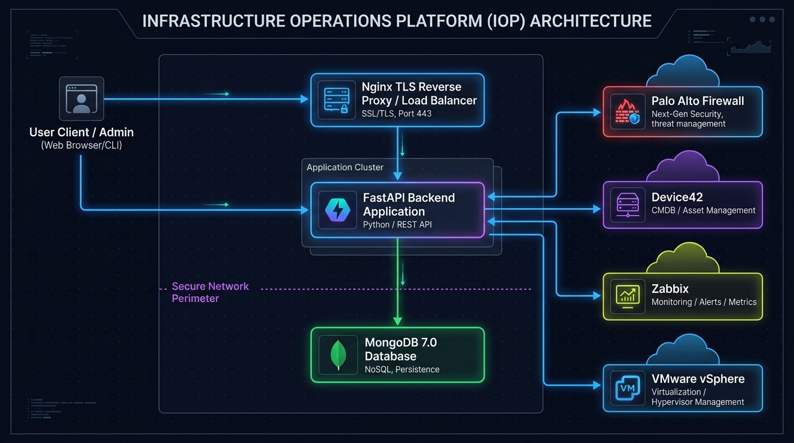
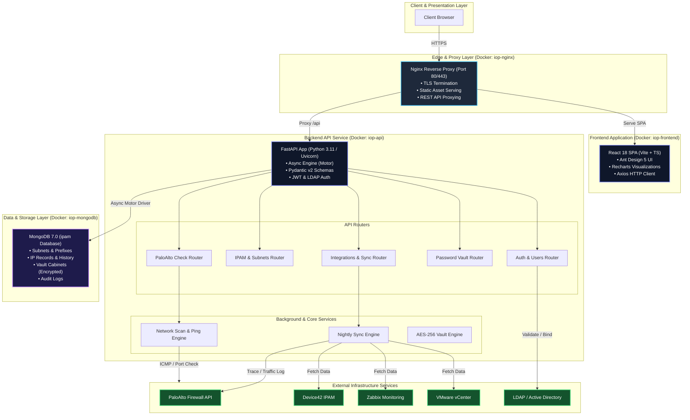
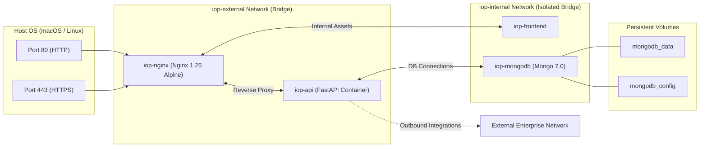
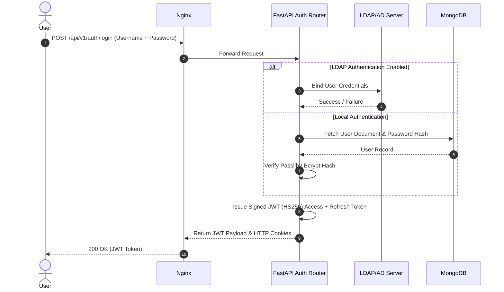
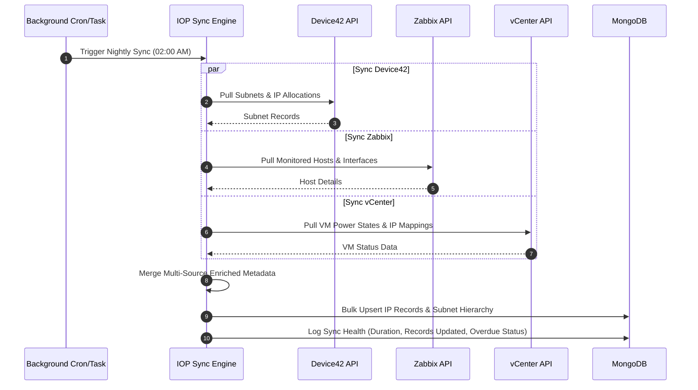
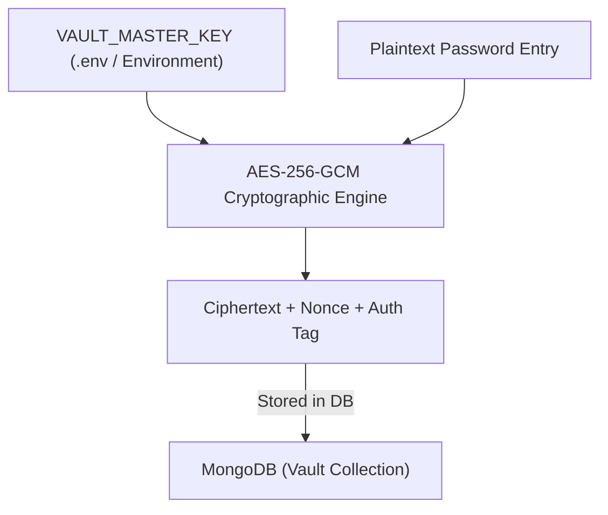

# 🏗️ IOP (Infrastructure Operations Platform) — Visual Architecture & Design Document

> **Project:** IOP (Infrastructure Operations Platform)  
> **Repository:** [rhelsenseizamiq/IOP](https://github.com/rhelsenseizamiq/IOP)  
> **Author:** Zamiq Mustafayev  

---

## 🖼️ Visual Architecture Diagrams

### 1. Detailed System & Component Architecture Diagram

### 2. High-Level Operations Overview Diagram

---

## 📐 High-Level System Architecture

---

## 🐳 Docker Deployment & Network Topology

---

## 🔄 Core Data & Operations Workflows

### 1. Authentication & Authorization Flow

### 2. Nightly Synchronization Workflow

---

## 🛡️ Security & Role-Based Access Control (RBAC) Matrix

| Role | Core IPAM Data | PaloAlto / Network Scans | Integrations (Discover/Import) | Vault Management |
| :--- | :--- | :--- | :--- | :--- |
| **Viewer** | 👁️ Read-Only | 🚫 Restricted | 🚫 Disabled | 🔑 Own Cabinets Only |
| **Operator** | 👁️ Read-Only | ⚡ Execute Scans & PaloAlto Check | 🚫 Disabled (View Only) | 🔑 Own Cabinets + Folder Management |
| **Administrator**| ✏️ Full Read/Write | ⚡ Full Access & Bulk Scans | 🚫 Disabled (View Only) | 🔑 Cabinet CRUD & Sharing |
| **SuperAdmin** | 👑 Full Access | 👑 Full Access | 🚀 Execute Discover / Import | 🔓 Delete Any Cabinet |

---

## 🔐 Password Vault Encryption Architecture

---

## 🧰 Technology Stack Summary

* **Frontend Framework:** React 18, Vite, TypeScript, Ant Design 5, Recharts, Tailwind CSS.
* **Backend Framework:** Python 3.11, FastAPI, Motor (Async MongoDB Driver), Pydantic v2.
* **Database Engine:** MongoDB 7.0 (`ipam` database).
* **Reverse Proxy & TLS:** Nginx 1.25 Alpine with dual-network isolation.
* **Authentication:** JWT (HS256) with optional LDAP/AD binding (`ldap3`).
* **Security:** AES-256-GCM Password Vault encryption, rate-limiting (`limits`), CORS enforcement, non-root container isolation.
